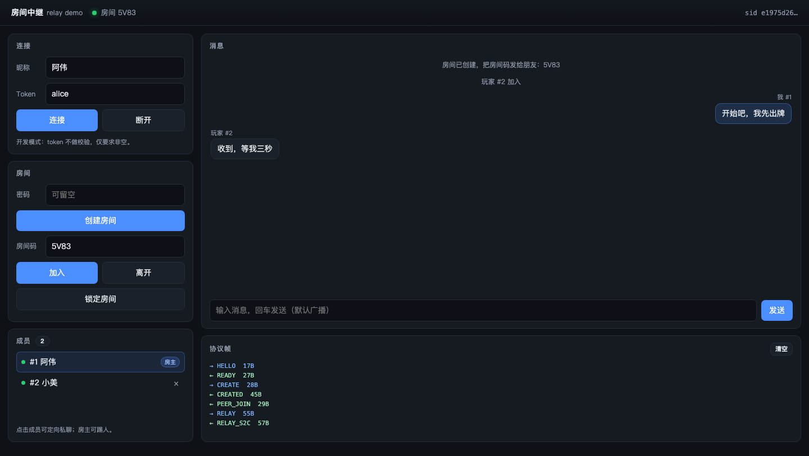

# 房间消息中继服务器（Go + WebSocket）

通用房间转发服务器：维护「谁在哪个房间」，按目标转发消息，**不解析业务负载**。
适合桌游、派对、卡牌、狼人杀等 ≤16 人的房间制游戏——游戏逻辑全在客户端/房主，服务器只负责把字节搬到对的人手里。



| 文档 | 内容 |
|------|------|
| [设计文档](docs/room-relay-design.md) | 架构、房间模型、并发与背压、容量指标、实施计划 |
| [协议 v2](docs/protocol-v2.md) | 二进制线格式、字节布局、重连时序 |
| [客户端接口](docs/api-reference.md) | 客户端要实现的全部行为、错误码、限制 |
| [猜数字示例](docs/bulls-game.md) | 双人玩法、游戏 payload、移动端界面、测试与排错 |

## 当前状态

M1 骨架 + 重连链路已可跑：

- 二进制协议（8 字节固定头，服务端零解析 payload）
- 房间 actor：成员表、seq、环形重放缓冲、宽限期
- 建房 / 加入 / 离开、4 位房间码、密码、锁定、踢人、房主转移
- 广播与**定向转发**（私聊、发牌、狼人身份这类私密消息）
- 心跳、断线重连、`lastSeq` 断点补发、窗口不足时的 `RESYNC`
- 每连接背压（慢客户端断开）、帧率限流、优雅退出
- 浏览器 demo（内嵌，无需构建）、JS 协议库（浏览器 / Node 通用）
- 测试：Go 单测 + Node 端到端 + Chrome 真机 UI 冒烟

**未做**：TCP/KCP 传输、观战、房间列表、持久化、真实鉴权（当前是开发桩）、多节点。

## 快速开始

```bash
# 需要 Go 1.27+
go run ./cmd/server
# 打开 http://localhost:8080
```

两个标签页：一个「连接 → 创建房间」，另一个输入房间码「连接 → 加入」。
点左侧成员可以定向私聊；刷新页面或断网可看到自动重连与消息补发。右下角是实时的协议帧日志。

## 示例游戏：猜数字（双人）

一个完整的示例游戏，演示「服务端只转发、规则全在客户端」：两人各设一个 4 位暗号（可重复、首位非 0），轮流猜对方的，每次只报「数字和位置同时对上几个」，先凑齐 4 个的人赢。

```bash
go run ./cmd/server
# 电脑：http://localhost:8080/bulls.html
# 手机（同一局域网）：http://<电脑局域网IP>:8080/bulls.html
```

一人「创建房间」拿到 4 位房间码，另一人输入房间码加入；满 2 人自动锁房。断网会自动重连补发，补发窗口不足时用快照同步局面。玩法、消息格式与实现细节见 [猜数字示例](docs/bulls-game.md)。

## 目录结构

```
cmd/server/            启动、配置、信号处理
internal/protocol/     帧编解码、op/错误码、黄金向量测试
internal/session/      连接封装：发送队列、背压、关闭语义
internal/room/         房间 actor：成员、seq、重放、宽限期、房主
internal/registry/     房间码索引、sid → (房间, 槽位) 索引
internal/server/       WS 接入、鉴权、分发、限流、优雅退出
web/                   内嵌页面：中继 demo + 猜数字（bulls.html / bulls.js / bulls-core.js）
web/test/              JS 编解码对账、真进程 e2e、Chrome 真机 UI（含手机视口）
docs/                  设计、协议、接口文档、猜数字说明
scripts/               测试用启动脚本
```

## 配置

| 参数 | 默认 | 说明 |
|------|------|------|
| `-addr` | `:8080` | HTTP 监听地址（同时提供 `/ws`、demo、`/healthz`） |
| `-max-members` | 16 | 单房人数上限 |
| `-max-rooms` | 10000 | 单进程房间数上限 |
| `-grace` | 60s | 断线宽限期 |
| `-ring-bytes` | 64KB | 每房间重放缓冲预算 |
| `-send-queue-bytes` | 256KB | 每连接发送队列预算，超了断开 |
| `-ping` | 20s | 服务端心跳间隔 |
| `-read-timeout` | 60s | 读空闲超时 |
| `-rate-limit` | 200 | 每连接每秒最大入站帧数 |
| `-create-per-min` | 10 | 每 IP 每分钟建房数 |
| `-log` | info | debug / info / warn / error |

## 测试

```bash
make test      # Go 单测（协议黄金字节、房间 actor、WS 端到端）
make test-race # 同上，带 race detector
make test-js   # JS 协议库对黄金向量做编解码校验 + 猜数字内核单测
make e2e       # 真进程 + 两个 Node 客户端：建房/转发/断线补发/踢人
make e2e-game  # 真进程 + 两个客户端把猜数字打满两局
make ui        # Chrome headless 驱动真实页面，产出 .tmp/demo.png
make ui-game   # Chrome headless：手机 390×844 + 桌面双视口打完整局，产出 .tmp/bulls-*.png
```

Go 与 JS 两个实现共用 `internal/protocol/testdata/vectors.json`，任何一边改了字节布局，另一边测试会立刻红。

## 负载约定

`payload` 对服务器不透明，格式由游戏决定。建议 protobuf；demo 用 JSON 方便肉眼调试：

```js
client.relay({ t: 'chat', text: 'hello' });       // 广播
client.relay({ t: 'deal', cards: [3, 7] }, [2]);  // 只发给 2 号位
```

## 重要边界

1. **服务端无权威**：看不懂业务消息，就无法校验，作弊成本为零。涉及虚拟货币/付费时不要用这个架构。
2. **单机内存态**：进程重启所有房间消失（派对游戏可接受）。
3. **token 不做校验**：`DevVerifier` 接受任何非空 token，上线前必须换成 HMAC/JWT。
4. **仅 WebSocket**：反代必须放行 `Upgrade`，且空闲超时 > 心跳间隔（20s）。
